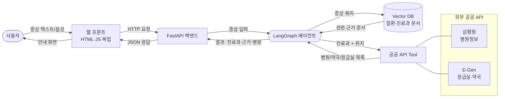
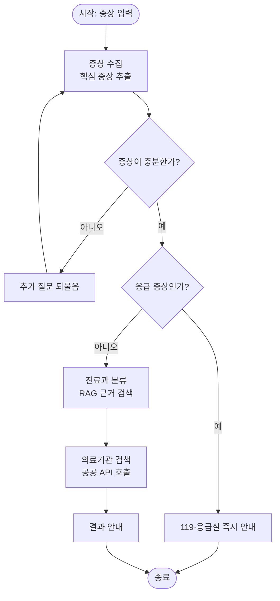
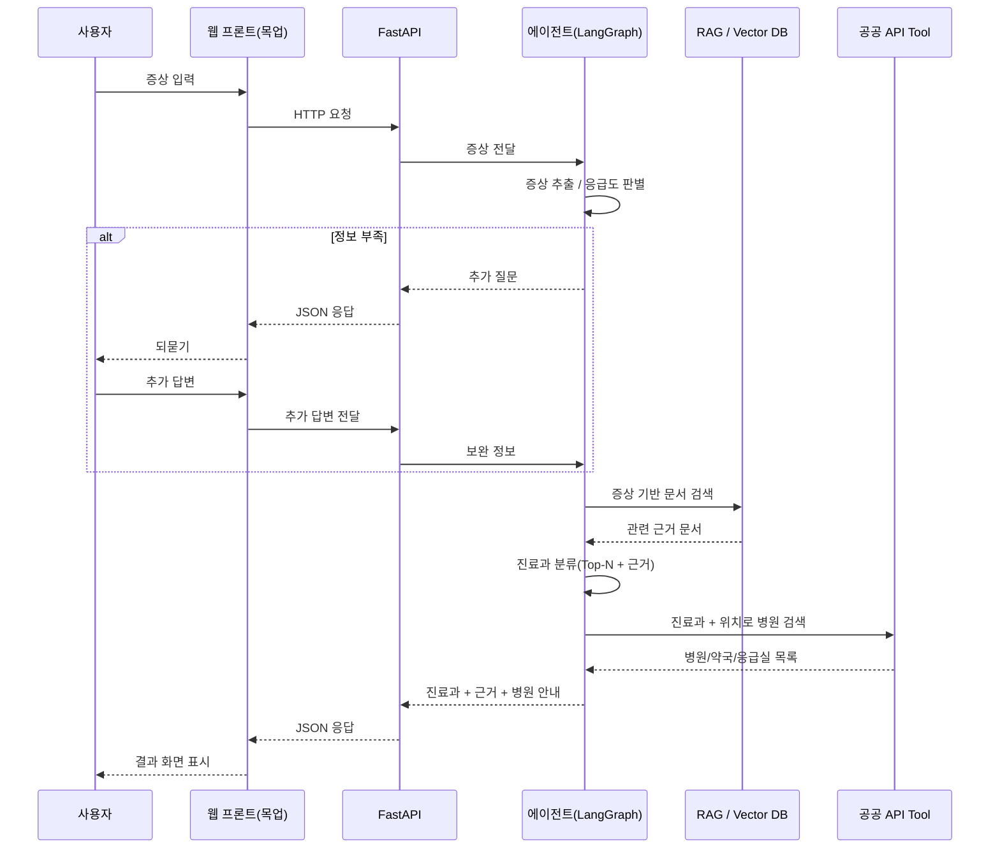
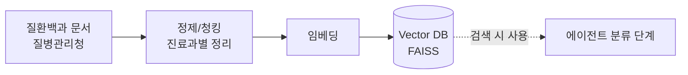
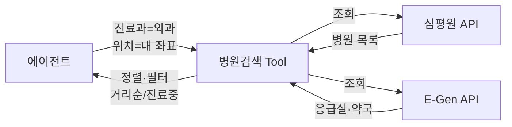

# 닥터라우터 Dr.Router — 데이터 흐름 설계

> AI 에이전트가 **증상 입력 → 진료과 분류 → 병원 안내**까지 처리하는 동안
> 데이터가 어떻게 흐르는지 정리한 문서. (구현 우선 / 최소 기능 기준)

---

## 1. 한눈에 보기 (전체 데이터 흐름)



> 프론트(목업 웹)와 에이전트는 **FastAPI**가 중계한다. 사용자가 보는 화면은 우리가 만든 HTML/JS 목업이고, 실제 처리는 백엔드에서 일어난다.

**핵심 데이터 4종류**
1. **사용자 입력** — 증상(자연어), (확장) 음성
2. **지식(RAG)** — 질환·진료과 설명 문서 → 분류 근거
3. **외부 데이터(API)** — 실제 병원·약국·응급실 목록
4. **상태(State)** — 에이전트가 단계마다 들고 다니는 문진 정보

---

## 2. 에이전트 내부 흐름 (상태 기반)



---

## 3. 단계별 입력 → 처리 → 출력

| 단계 | 입력(IN) | 처리 | 출력(OUT) |
|---|---|---|---|
| ① 증상 수집 | 사용자 발화 | 핵심 증상 추출, 부족하면 되물음 | `symptoms[]` |
| ② 응급도 판별 | `symptoms` | 응급 키워드/규칙 체크 | `emergency: true/false` |
| ③ 진료과 분류 | `symptoms` | RAG 검색 → 근거 기반 분류 | `departments[] (Top-N + 근거)` |
| ④ 의료기관 검색 | `department`, `location` | 공공 API 호출 | `hospitals[]` |
| ⑤ 결과 안내 | 위 전체 | 조합 + 면책 문구 | 최종 응답 |

### 에이전트 State 예시 (단계마다 갱신되는 데이터)

```json
{
  "user_input": "어제부터 오른쪽 아랫배가 아프고 열이 나요",
  "symptoms": ["우하복부 통증", "미열", "구토"],
  "need_more_info": false,
  "emergency": false,
  "departments": [
    { "name": "외과",       "score": 0.87, "reason": "우하복부 통증+발열 → 충수염 의심" },
    { "name": "내과",       "score": 0.63, "reason": "위장관 염증 가능성" }
  ],
  "location": { "lat": 37.56, "lng": 126.97 },
  "hospitals": [
    { "name": "서울튼튼외과", "dept": "외과", "dist_m": 320, "open": true }
  ]
}
```

> State 하나를 노드들이 **읽고 → 채워 넣으며** 다음 노드로 넘긴다. (LangGraph의 핵심)

---

## 4. 사용자 ~ 시스템 시퀀스 (요청 한 번의 흐름)



---

## 5. RAG 데이터 준비 흐름 (사전 1회 구축)



**주의점**
- 질환백과는 양이 많음 → **"진료과별 대표 증상·담당 질환"** 요약 형태로 청킹하는 게 분류 정확도에 유리.
- 출처 표시(공공누리 4유형) 유지.

---

## 6. 외부 API 데이터 (Tool 입출력)

| API | 입력 | 받는 데이터 |
|---|---|---|
| 심평원 병원정보 | 지역, 진료과목 | 병원명, 주소, 진료과, 좌표 |
| E-Gen | 위치, 반경 | 응급실·약국, 실시간 병상, 운영시간 |



---

## 7. 구현 시 데이터 관점 체크리스트

- [ ] State 스키마(위 3번) 먼저 **팀 공통으로 확정** → 모듈 간 충돌 방지
- [ ] RAG용 진료과 문서 **최소 버전**(주요 과 10~15개)부터 구축
- [ ] 응급 판별은 **규칙(키워드) + LLM 병행** — 안전이 최우선
- [ ] API 응답은 그대로 쓰지 말고 **{병원명, 진료과, 거리, 운영여부}** 로 정규화
- [ ] 모든 결과에 **"의학적 진단 아님 / 응급 시 119"** 문구 고정

---

*본 문서는 구현 설계용 초안입니다. 기능 구현 진행하며 State 스키마와 흐름을 업데이트하세요.*
